<div align="center">

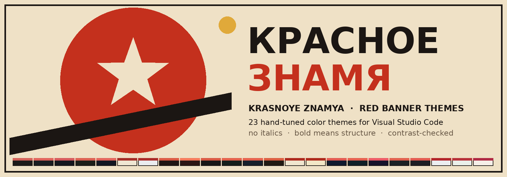

# Krasnoye Znamya
### Red Banner Themes for Visual Studio Code

*23 hand-tuned color themes drawn from the flat, bold color language of 20th-century poster art.*

   

[Install](#install) · [The collection](#the-collection) · [Design principles](#design-principles) · [Recommended settings](#recommended-settings) · [FAQ](#faq)

</div>

---

**Krasnoye Znamya** (Russian for *Red Banner*) is a single VS Code extension that contains 23 themes in three packs. Every theme is built around one idea: **a strong, flat, limited palette that stays comfortable for hours.** Dark and light, warm and cold, calm and colorful, so there is one for every room and every hour.

| Pack | Themes | Character |
|---|---|---|
| **Soviet** | 7 | Constructivist reds, brass, steel and cosmos. Seven themes that run from warm charcoal to pale winter paper. |
| **Red Sun** | 8 | Vermilion, sun yellow, rice-paper cream, jade and ink: the flat color language of Chinese poster art. Eight themes, six dark and two light. |
| **Juche** | 8 | Flag blue and red, Paektu snow, stadium lights and pastel facades: the visual world of North Korean poster art. Eight themes, five dark and three light. |

## Design principles

- **No italics, anywhere.** Comments, parameters, `self` and Markdown emphasis are told apart by color, never by slant.
- **Bold means structure.** Keywords, `def` and `class`, function and class definitions, decorators and `None` / `True` / `False` are bold. Calls, strings, numbers and variables stay regular, so the skeleton of your code shows at a glance.
- **Comfort is measured, not guessed.** Every theme passes automated checks: syntax colors reach at least 4.5:1 contrast, the main text brightness stays in a comfortable band (no glare), selected text stays readable, syntax hues stay clearly distinct from each other, and color intensity is capped so nothing burns.
- **Complete interface.** About 300 workbench colors per theme: tabs, sidebar, status bar, terminal, notifications, debugger, tests, diff and merge views, inlay hints, sticky scroll and more.
- **Poster details.** The status bar is a colored banner with a thin trim line, and the active tab carries a colored top edge with an accent underline.

## Install

### From a release (recommended)

Download `krasnoye-znamya.vsix` from the [Releases](../../releases) page and run:

```bash
code --install-extension krasnoye-znamya.vsix --force
```

Prefer the interface? Open the Extensions view, click the `...` menu at the top of the panel, choose **Install from VSIX...** and select the file.

### From source

```bash
git clone https://github.com/Zanjare/krasnoye-znamya.git
cd krasnoye-znamya
npx @vscode/vsce package --no-rewrite-relative-links
code --install-extension krasnoye-znamya-*.vsix --force
```

### Pick a theme

Restart VS Code, press `Ctrl+K` then `Ctrl+T` (`Cmd+K` then `Cmd+T` on macOS), move through the list with the arrow keys to preview each theme live, and press `Enter` to keep one.

### Uninstall

```bash
code --uninstall-extension amir.krasnoye-znamya
```

## The collection

| Theme | Type | Pack | Character |
|---|---|---|---|
| [Soviet Dusk II](#soviet-dusk-ii) | dark | Soviet | Warm charcoal, aged paper, brass and crimson |
| [Soviet Steel](#soviet-steel) | dark | Soviet | Cold slate, factory light, one red star |
| [Soviet Kremlin Night](#soviet-kremlin-night) | dark | Soviet | Blue-black night, ruby and bright gold |
| [Soviet Olive](#soviet-olive) | dark | Soviet | Army olive, khaki and brass |
| [Soviet Cosmos](#soviet-cosmos) | dark | Soviet | Deep space blue and cosmonaut orange |
| [Soviet Paper](#soviet-paper) | light | Soviet | Aged poster paper, ink and crimson |
| [Soviet Winter](#soviet-winter) | light | Soviet | Pale winter paper, steel blue and red |
| [Red Sun Lacquer](#red-sun-lacquer) | dark | Red Sun | Red-black lacquer under a sun-yellow glow |
| [Crimson Hall](#crimson-hall) | dark | Red Sun | Deep maroon, gold and cream |
| [Ink and Seal](#ink-and-seal) | dark | Red Sun | Ink charcoal and a single red seal |
| [Jade Fields](#jade-fields) | dark | Red Sun | Deep jade green with a red star on the horizon |
| [Cadre Blue](#cadre-blue) | dark | Red Sun | Blue-grey tunic cloth, coral red and brass |
| [Loess Earth](#loess-earth) | dark | Red Sun | Yellow earth, ochre and burnt sienna |
| [Rice Paper Poster](#rice-paper-poster) | light | Red Sun | Rice paper, ink and a vermilion seal |
| [Sunflower Dawn](#sunflower-dawn) | light | Red Sun | Warm sunflower cream, red and brown ink |
| [Chollima Navy](#chollima-navy) | dark | Juche | Flag navy with a red banner |
| [Paektu Heaven Lake](#paektu-heaven-lake) | dark | Juche | Crater-lake teal under snow-white text |
| [Arirang Night](#arirang-night) | dark | Juche | Stadium indigo and card-stunt colors |
| [Taedong Dusk](#taedong-dusk) | dark | Juche | River dusk with amber city lights |
| [Mansudae Mural](#mansudae-mural) | dark | Juche | A neutral wall with mural primaries |
| [Juche Granite](#juche-granite) | light | Juche | White granite, flame red and flag blue |
| [Pyongyang Pastel](#pyongyang-pastel) | light | Juche | Pastel mint and pink facades |
| [Magnolia Spring](#magnolia-spring) | light | Juche | Ivory blossom, rose and leaf green |

> The images below are rendered mockups of each theme, not real screenshots. Under each one you can see ten key colors: editor background, text, keywords, functions, strings, types, numbers, constants, modules and the status bar.

---

## Soviet pack

Constructivist reds, brass, steel and cosmos. Seven themes that run from warm charcoal to pale winter paper.

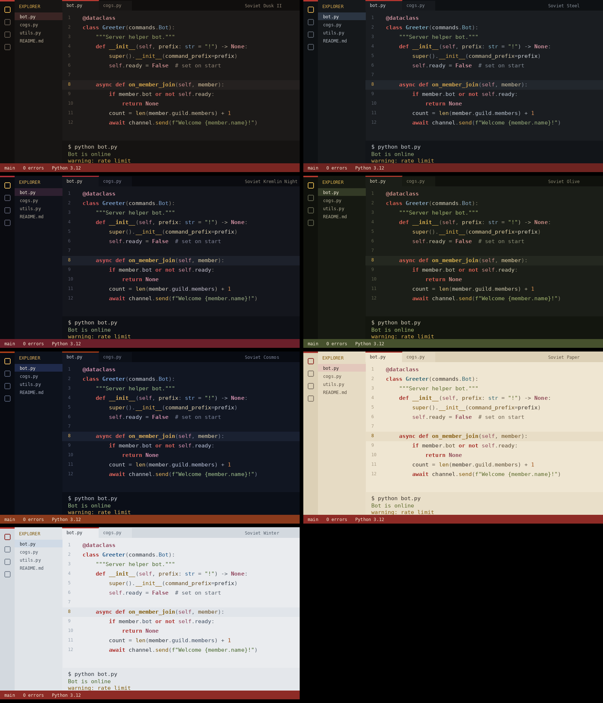

### Soviet Dusk II

<p align="center">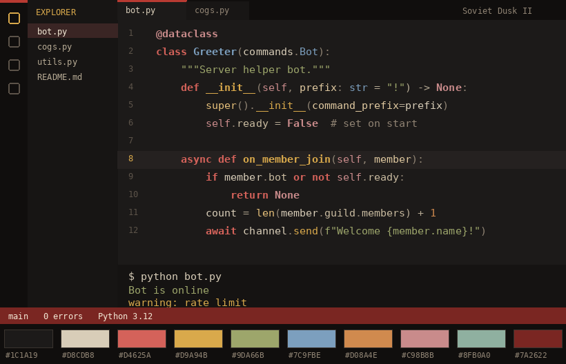</p>

**Dark theme · Soviet pack** — Warm charcoal, aged paper, brass and crimson

The all-rounder. A warm charcoal ground like a print-shop wall at dusk, text the color of aged poster paper, muted crimson keywords and brass-gold functions. Nothing shouts and everything reads.

Best for: all-day coding, the safe first pick.

`bg #1C1A19` · `text #D8CDB8` · `keywords #D4625A` · `functions #D9A94B` · `strings #9DA66B` · `types #7C9FBE`

### Soviet Steel

<p align="center">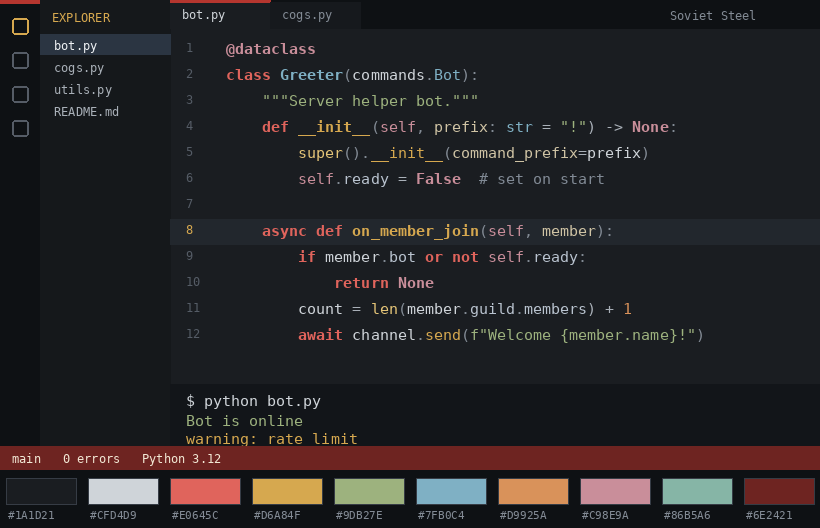</p>

**Dark theme · Soviet pack** — Cold slate, factory light, one red star

Industrial grey-blue with icy blue types and a restrained red for control flow. Cooler and sharper than Dusk II, with a deep red banner at the bottom of the window.

Best for: focused daytime work.

`bg #1A1D21` · `text #CFD4D9` · `keywords #E0645C` · `functions #D6A84F` · `strings #9DB27E` · `types #7FB0C4`

### Soviet Kremlin Night

<p align="center">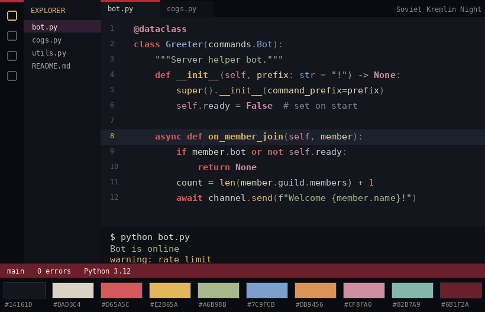</p>

**Dark theme · Soviet pack** — Blue-black night, ruby and bright gold

A deep midnight ground with parchment text, brighter gold functions and ruby keywords, like lit towers against a night sky. The most dramatic of the Soviet dark themes.

Best for: late-night sessions.

`bg #14161D` · `text #DAD3C4` · `keywords #D65A5C` · `functions #E2B65A` · `strings #A6B98B` · `types #7C9FCB`

### Soviet Olive

<p align="center">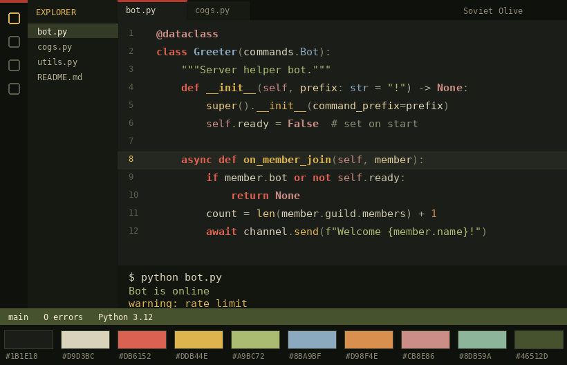</p>

**Dark theme · Soviet pack** — Army olive, khaki and brass

An olive-black ground, khaki text and an olive-drab status bar. Earthy, low-stimulation and calm, with red kept for structure only.

Best for: very long sessions.

`bg #1B1E18` · `text #D9D3BC` · `keywords #DB6152` · `functions #DDB44E` · `strings #A9BC72` · `types #8BA9BF`

### Soviet Cosmos

<p align="center">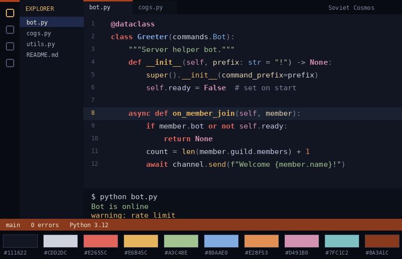</p>

**Dark theme · Soviet pack** — Deep space blue and cosmonaut orange

A space-blue ground with starlight text. Orange numbers and gold functions glow like instrument panels, with a burnt-orange banner at the bottom.

Best for: night owls.

`bg #111622` · `text #CDD2DC` · `keywords #E2655C` · `functions #E6B45C` · `strings #A3C48E` · `types #80AAE0`

### Soviet Paper

<p align="center">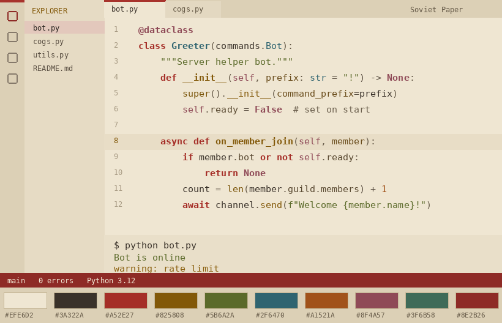</p>

**Light theme · Soviet pack** — Aged poster paper, ink and crimson

A warm light theme on yellowed paper: ink-dark text, deep crimson keywords, olive strings and a red banner status bar. It reads like a printed page.

Best for: bright rooms and daylight.

`bg #EFE6D2` · `text #3A322A` · `keywords #A52E27` · `functions #825808` · `strings #5B6A2A` · `types #2F6470`

### Soviet Winter

<p align="center">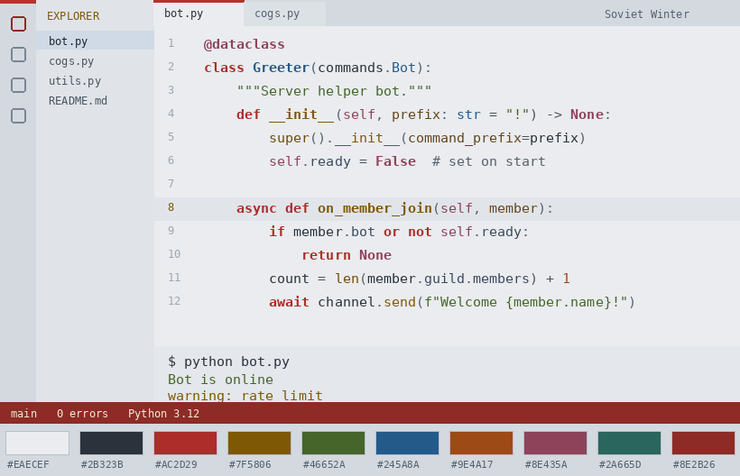</p>

**Light theme · Soviet pack** — Pale winter paper, steel blue and red

A cool, crisp light theme in pale grey-blue. Steel-blue types, red keywords and a clean, calm surface.

Best for: daytime and bright offices.

`bg #EAECEF` · `text #2B323B` · `keywords #AC2D29` · `functions #7F5806` · `strings #46652A` · `types #245A8A`

---

## Red Sun pack

Vermilion, sun yellow, rice-paper cream, jade and ink: the flat color language of Chinese poster art. Eight themes, six dark and two light.

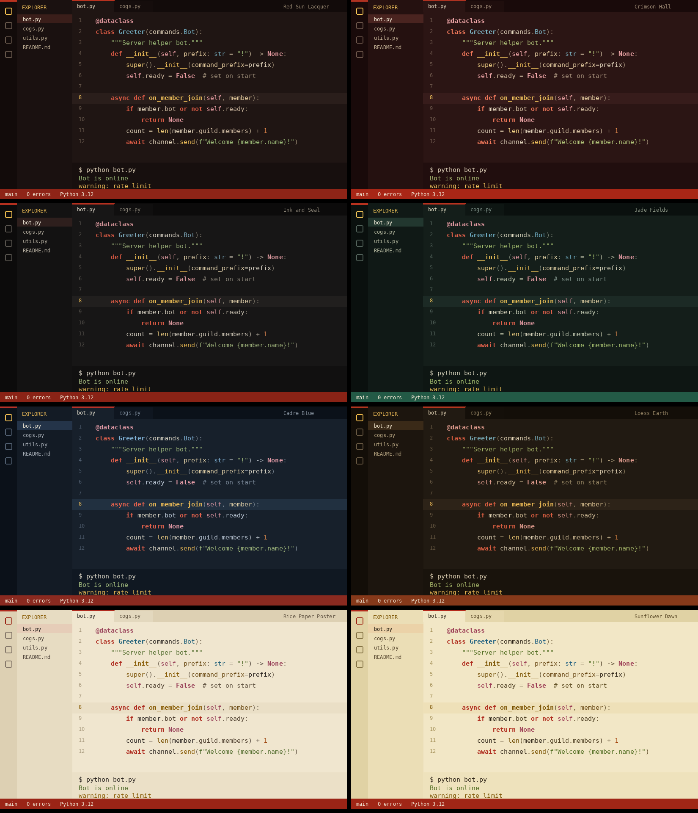

### Red Sun Lacquer

<p align="center">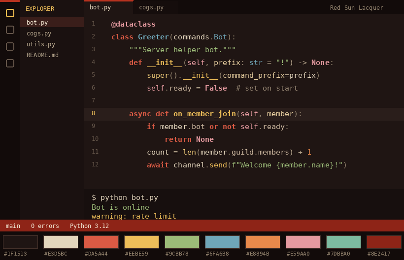</p>

**Dark theme · Red Sun pack** — Red-black lacquer under a sun-yellow glow

The signature theme of the Red Sun pack. A deep lacquer ground, rice-paper cream text, vermilion keywords and sun-yellow functions, with a vermilion banner at the bottom.

Best for: evening coding with warm contrast.

`bg #1F1513` · `text #E3D5BC` · `keywords #DA5A44` · `functions #EEBE59` · `strings #9CBB78` · `types #6FA6B8`

### Crimson Hall

<p align="center">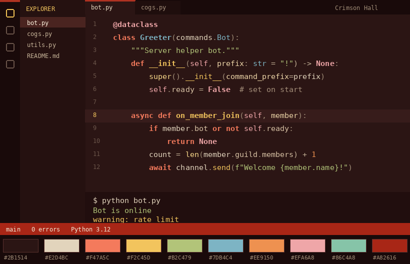</p>

**Dark theme · Red Sun pack** — Deep maroon, gold and cream

The boldest ground in the collection: a rich maroon like the drapery of a grand hall, balanced by cream text and bright gold. A theme with presence that stays soft on the eyes.

Best for: people who like color around their code.

`bg #2B1514` · `text #E2D4BC` · `keywords #F47A5C` · `functions #F2C45D` · `strings #B2C479` · `types #7DB4C4`

### Ink and Seal

<p align="center">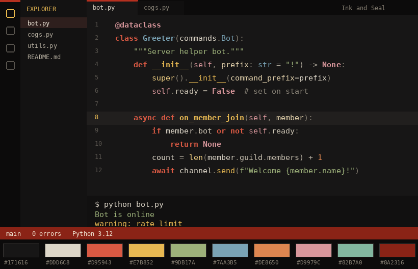</p>

**Dark theme · Red Sun pack** — Ink charcoal and a single red seal

A neutral, restrained ink-charcoal ground. Red appears like a seal stamp and gold in small doses. The most minimal and elegant of the dark themes.

Best for: minimalists.

`bg #171616` · `text #DDD6C8` · `keywords #D95943` · `functions #E7B852` · `strings #9DB17A` · `types #7AA3B5`

### Jade Fields

<p align="center">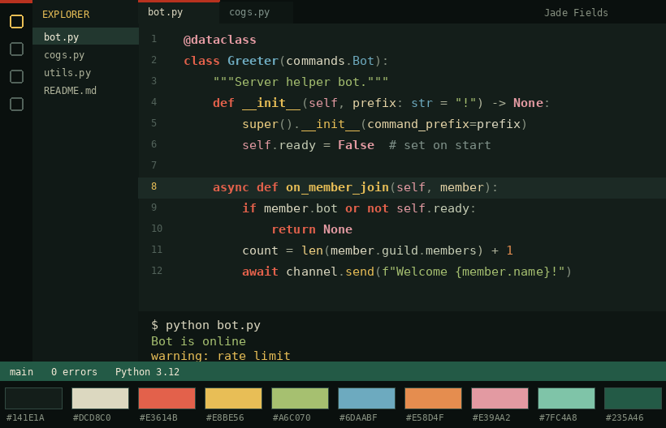</p>

**Dark theme · Red Sun pack** — Deep jade green with a red star on the horizon

A pine-jade ground, leaf-green strings, vermilion keywords and a jade banner status bar. Natural, calm and quietly rich.

Best for: calm, long sessions.

`bg #141E1A` · `text #DCD8C0` · `keywords #E3614B` · `functions #E8BE56` · `strings #A6C070` · `types #6DAABF`

### Cadre Blue

<p align="center">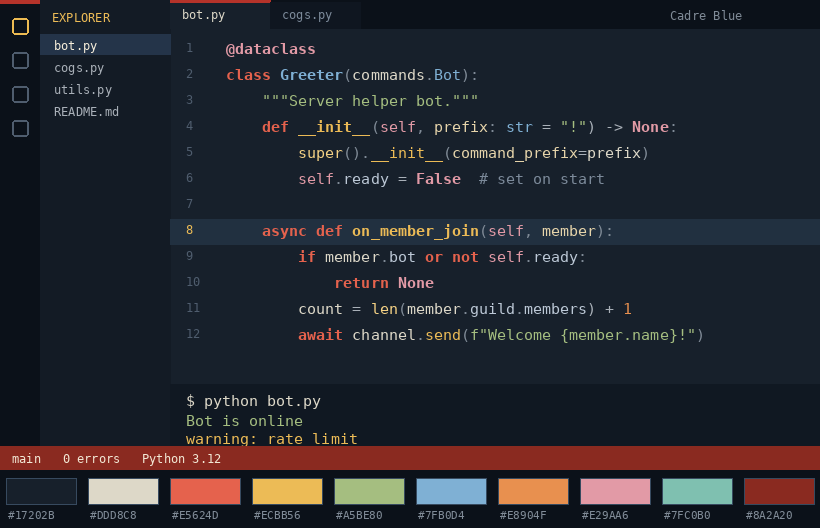</p>

**Dark theme · Red Sun pack** — Blue-grey tunic cloth, coral red and brass

A slate-blue ground like worn uniform cloth, with cream text, coral-red keywords and brass-gold functions. Cool surroundings, warm accents.

Best for: balanced, cool-toned work.

`bg #17202B` · `text #DDD8C8` · `keywords #E5624D` · `functions #ECBB56` · `strings #A5BE80` · `types #7FB0D4`

### Loess Earth

<p align="center">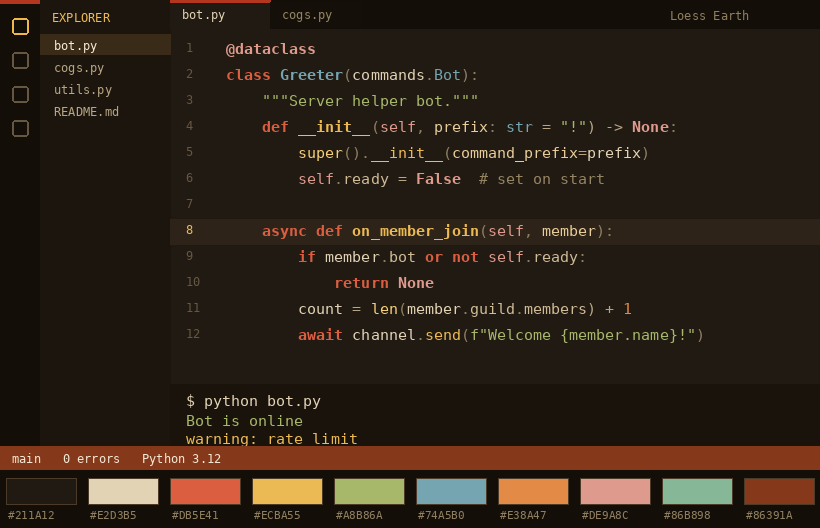</p>

**Dark theme · Red Sun pack** — Yellow earth, ochre and burnt sienna

A warm brown ground like sun-baked clay, ochre text accents and a burnt-sienna banner. The coziest dark theme in the pack.

Best for: cozy evening sessions.

`bg #211A12` · `text #E2D3B5` · `keywords #DB5E41` · `functions #ECBA55` · `strings #A8B86A` · `types #74A5B0`

### Rice Paper Poster

<p align="center">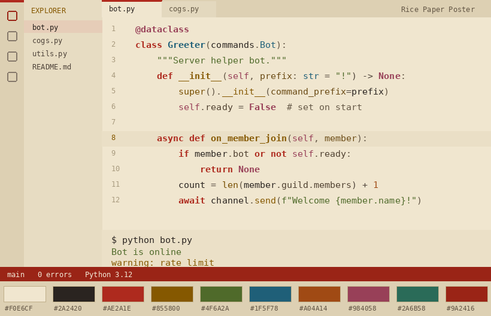</p>

**Light theme · Red Sun pack** — Rice paper, ink and a vermilion seal

A light theme on warm rice paper: ink-black text, a vermilion seal red for keywords and deep jade for modules. Refined and print-like.

Best for: daylight, writing and reading code.

`bg #F0E6CF` · `text #2A2420` · `keywords #AE2A1E` · `functions #855800` · `strings #4F6A2A` · `types #1F5F78`

### Sunflower Dawn

<p align="center">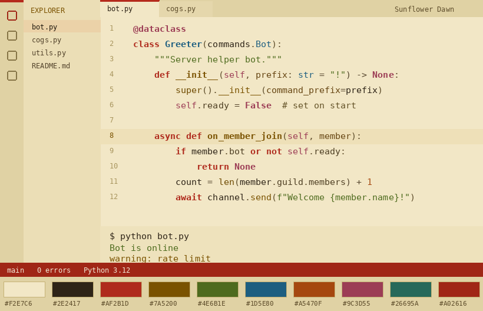</p>

**Light theme · Red Sun pack** — Warm sunflower cream, red and brown ink

A sunlit cream ground with brown-ink text and deep red keywords. Gentle and warm, never glaring.

Best for: sunny rooms.

`bg #F2E7C6` · `text #2E2417` · `keywords #AF2B1D` · `functions #7A5200` · `strings #4E6B1E` · `types #1D5E80`

---

## Juche pack

Flag blue and red, Paektu snow, stadium lights and pastel facades: the visual world of North Korean poster art. Eight themes, five dark and three light.

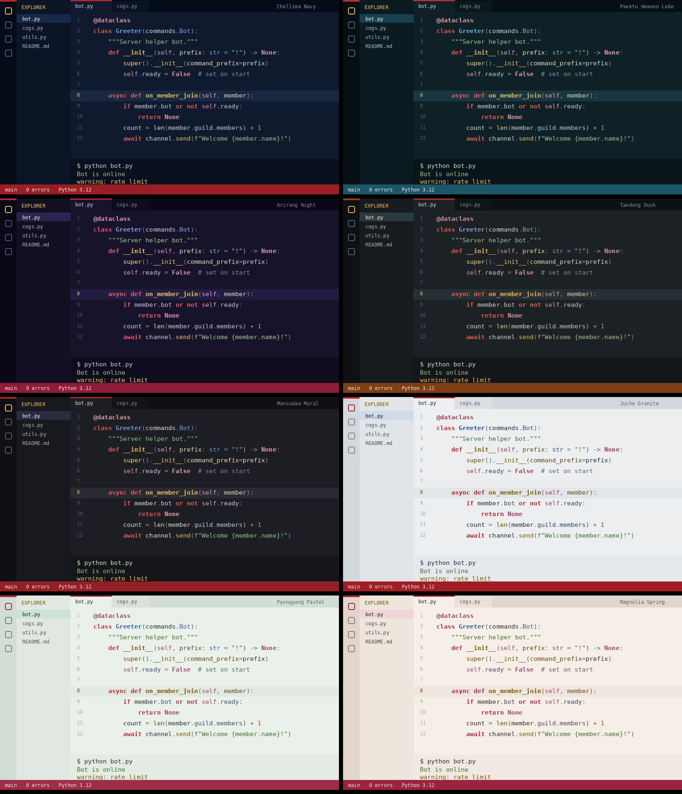

### Chollima Navy

<p align="center">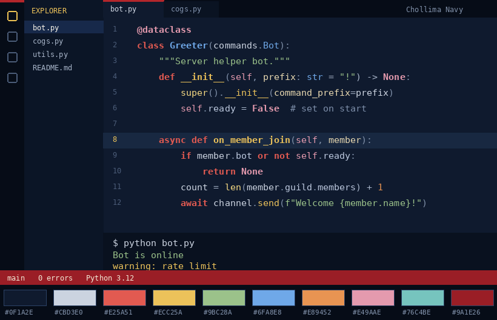</p>

**Dark theme · Juche pack** — Flag navy with a red banner

A deep navy ground, snow-tinted text, bright flag blue for types and a red banner status bar. Crisp and confident.

Best for: focused work at any hour.

`bg #0F1A2E` · `text #CBD3E0` · `keywords #E25A51` · `functions #ECC25A` · `strings #9BC28A` · `types #6FA8E8`

### Paektu Heaven Lake

<p align="center">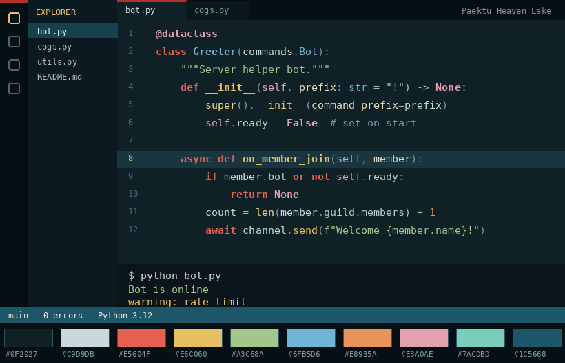</p>

**Dark theme · Juche pack** — Crater-lake teal under snow-white text

A deep teal ground like still mountain water, cold white text, lake-blue types and a teal status bar. Quiet and clear.

Best for: calm night work.

`bg #0F2027` · `text #C9D9DB` · `keywords #E5604F` · `functions #E6C060` · `strings #A3C68A` · `types #6FB5D6`

### Arirang Night

<p align="center">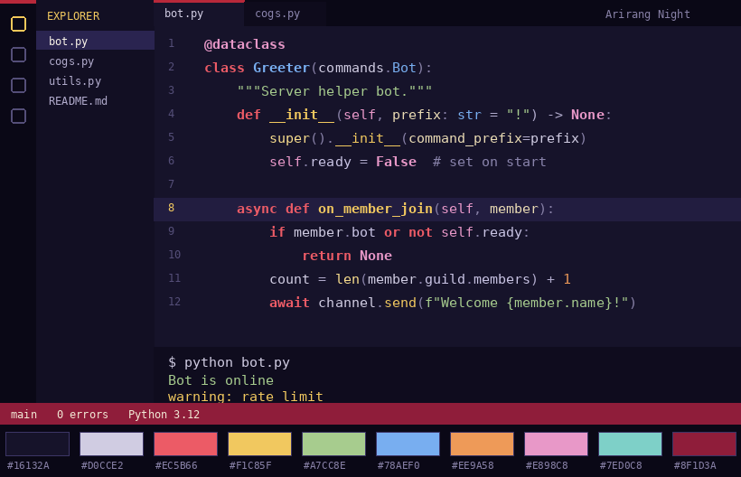</p>

**Dark theme · Juche pack** — Stadium indigo and card-stunt colors

An indigo-violet ground with red, gold, sky blue and pink accents, like a stadium full of colored cards under floodlights. The most colorful dark theme.

Best for: colorful, playful evenings.

`bg #16132A` · `text #D0CCE2` · `keywords #EC5B66` · `functions #F1C85F` · `strings #A7CC8E` · `types #78AEF0`

### Taedong Dusk

<p align="center">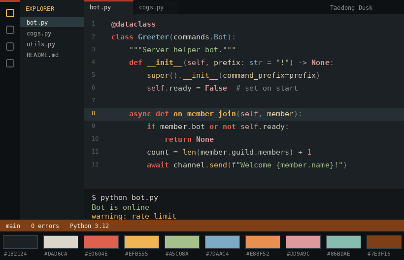</p>

**Dark theme · Juche pack** — River dusk with amber city lights

A grey-teal ground with warm amber gold, soft sage greens and a sienna banner, like lights reflecting on a river at dusk.

Best for: twilight hours.

`bg #1B2124` · `text #DAD6CA` · `keywords #E0604E` · `functions #EFB555` · `strings #A5C08A` · `types #7DAAC4`

### Mansudae Mural

<p align="center">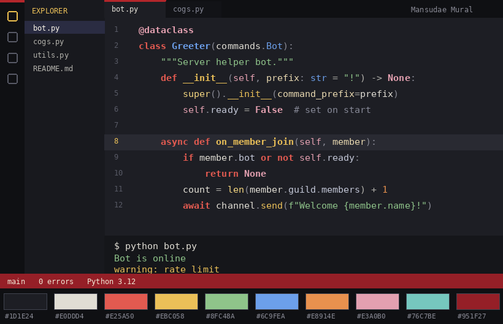</p>

**Dark theme · Juche pack** — A neutral wall with mural primaries

A neutral graphite ground that lets the primary mural colors speak: poster red, sky blue, sun yellow and grass green, each well separated.

Best for: readability of many token types.

`bg #1D1E24` · `text #E0DDD4` · `keywords #E25A50` · `functions #EBC058` · `strings #8FC48A` · `types #6C9FEA`

### Juche Granite

<p align="center">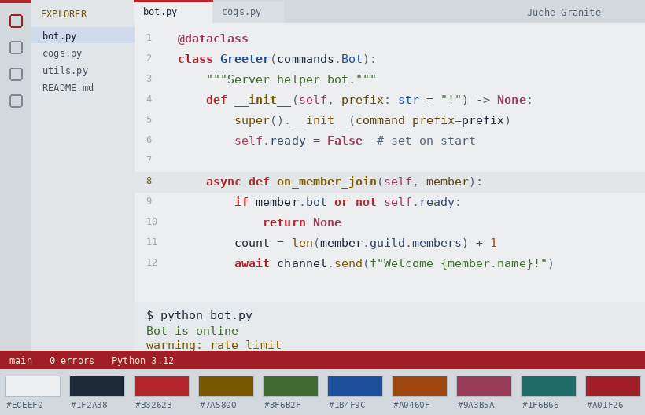</p>

**Light theme · Juche pack** — White granite, flame red and flag blue

A cool white light theme: granite-grey surfaces, flame-red keywords and a deep flag blue for types. Clean and monumental.

Best for: bright daytime work.

`bg #ECEEF0` · `text #1F2A38` · `keywords #B3262B` · `functions #7A5800` · `strings #3F6B2F` · `types #1B4F9C`

### Pyongyang Pastel

<p align="center">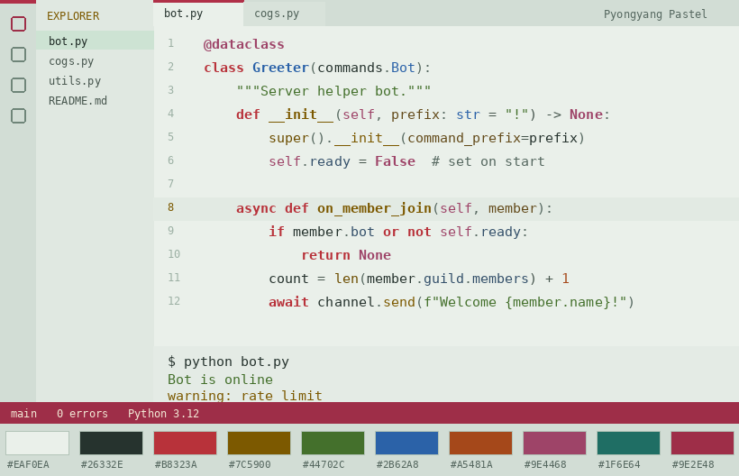</p>

**Light theme · Juche pack** — Pastel mint and pink facades

A soft mint-white light theme with a raspberry banner and carefully darkened accents, so the pastel mood never costs contrast.

Best for: gentle daytime reading.

`bg #EAF0EA` · `text #26332E` · `keywords #B8323A` · `functions #7C5900` · `strings #44702C` · `types #2B62A8`

### Magnolia Spring

<p align="center">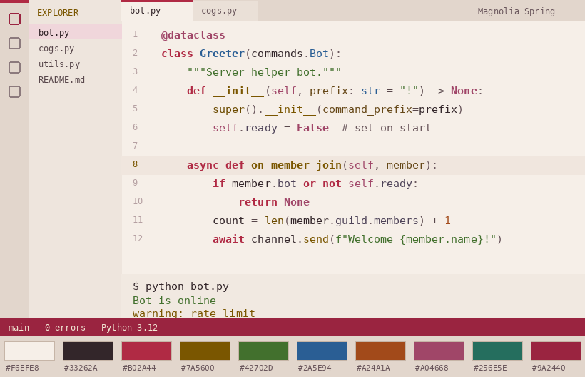</p>

**Light theme · Juche pack** — Ivory blossom, rose and leaf green

An ivory-blush light theme with magnolia rose keywords and leaf-green strings. The softest light theme in the collection.

Best for: relaxed daytime sessions.

`bg #F6EFE8` · `text #33262A` · `keywords #B02A44` · `functions #7A5600` · `strings #42702D` · `types #2A5E94`

---

## All palettes at a glance

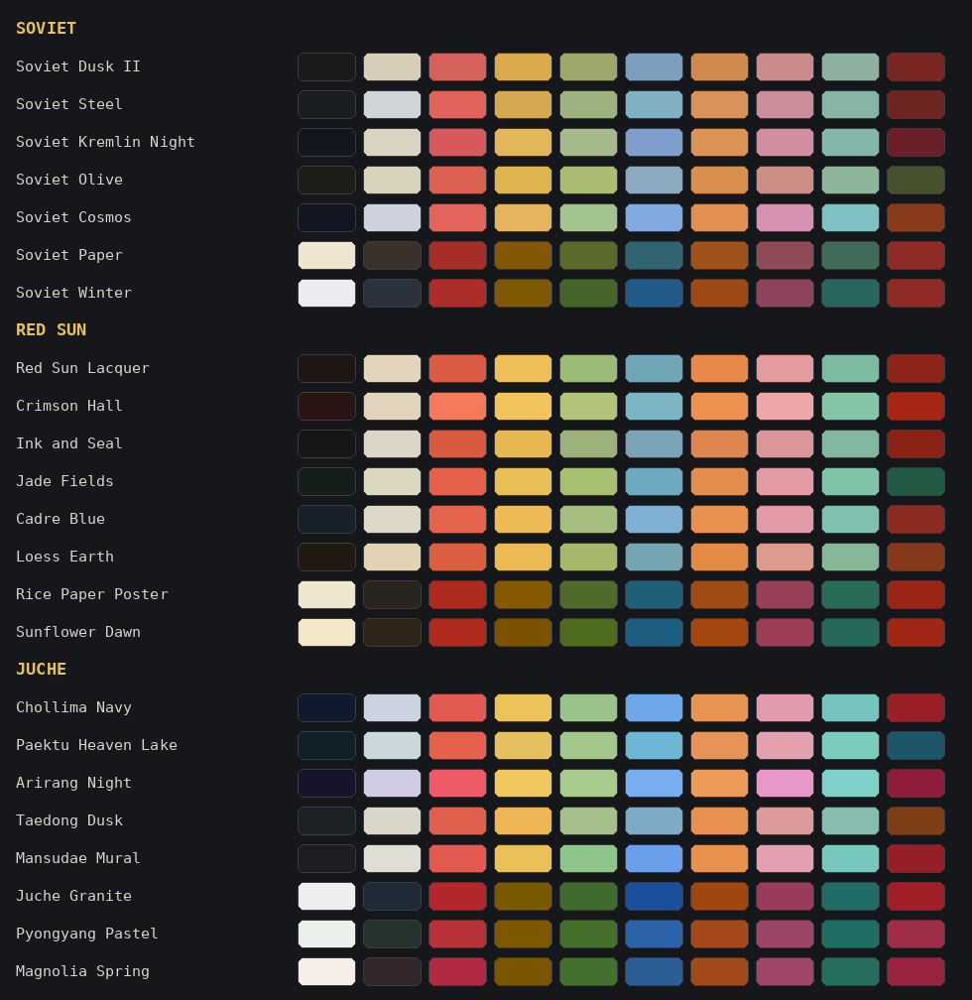

## Recommended settings

The themes work with any font. Bold looks cleanest in a monospace font that ships a real bold weight, such as JetBrains Mono or Fira Code. A ready-to-paste snippet is in [`docs/recommended-settings.jsonc`](docs/recommended-settings.jsonc). The essentials:

```jsonc
{
  "editor.fontWeight": "normal",
  "editor.fontFamily": "'JetBrains Mono', 'Fira Code', monospace",
  "editor.lineHeight": 1.7,
  "editor.bracketPairColorization.enabled": true,
  "editor.guides.bracketPairs": "active",
  "editor.semanticHighlighting.enabled": true
}
```

## FAQ

**How do I switch themes?** Press `Ctrl+K` then `Ctrl+T`, or open the Command Palette (`Ctrl+Shift+P`) and run *Preferences: Color Theme*.

**Why are there no italics?** Slanted text is the first thing to blur at small sizes and in many monospace fonts. Here, color carries the meaning and bold carries the structure.

**Can I change one color?** Yes. Override it in your `settings.json` without touching the theme:

```jsonc
{
  "editor.tokenColorCustomizations": {
    "[Soviet Dusk II]": {
      "comments": "#9A8C78"
    }
  }
}
```

**A theme looks slightly different in some language.** Colors come from the language extension's syntax rules and, where available, its language server (semantic highlighting). The themes cover the common languages (Python, JavaScript and TypeScript, HTML, CSS, JSON, YAML, TOML, Markdown, Shell, SQL, Rust, C and C++), but each language extension decides how finely code is split into tokens.

## About the aesthetic

Poster art is a rich graphic tradition built on flat color, strong geometry and limited palettes. These themes borrow **the color language only**. They contain no portraits, slogans or political messaging, and they make no political statement.

## Contributing

Found a color that is hard to read in some language? Open an issue with a short code sample and the theme name. Pull requests that tweak a single theme file are welcome.

## License

MIT, see [LICENSE](LICENSE). Publishing guide: [docs/PUBLISHING.md](docs/PUBLISHING.md).

<div align="center">

**Krasnoye Znamya** · Red Banner Themes

</div>
